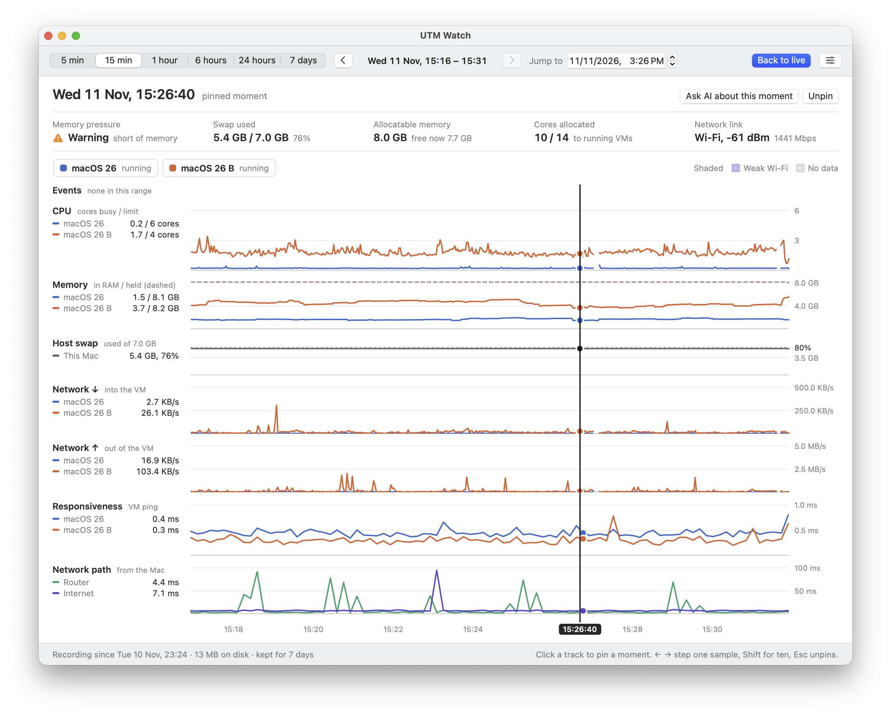
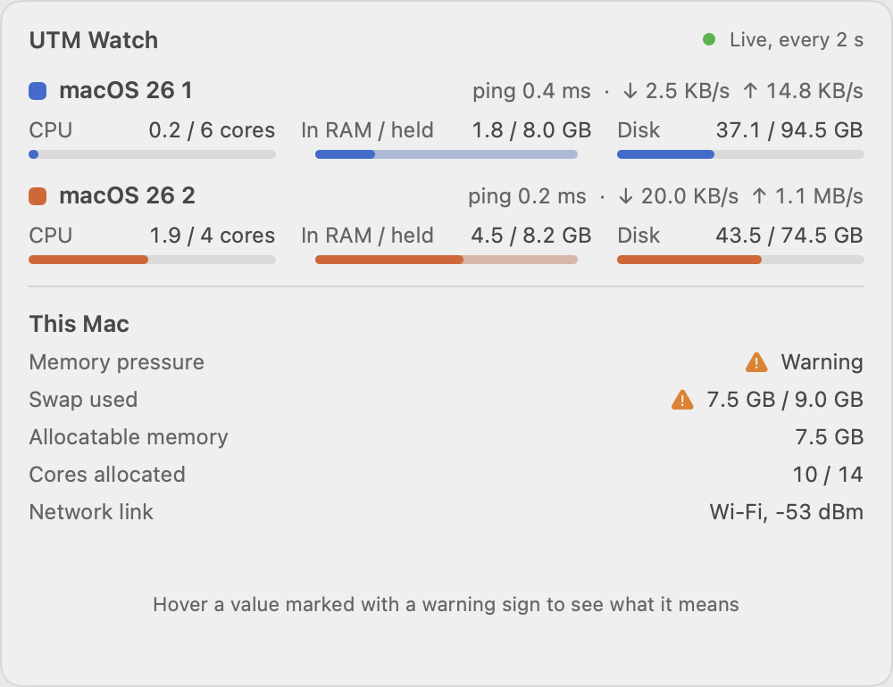
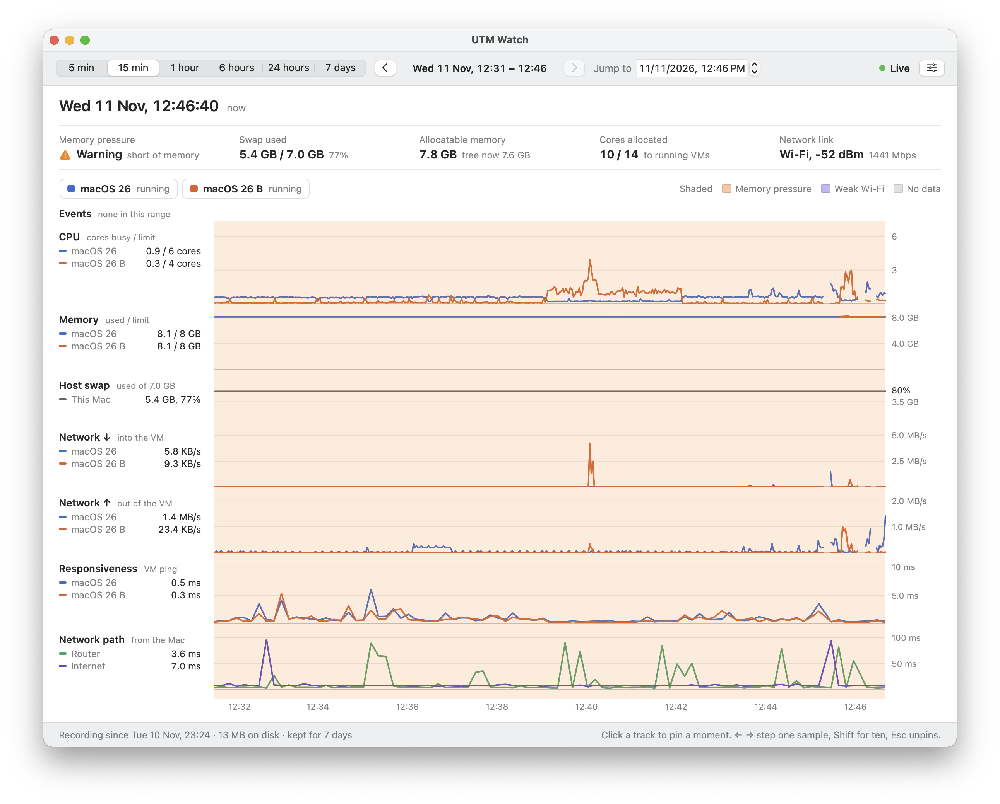

# UTM Watch

See what each of your [UTM](https://mac.getutm.app) virtual machines is really doing, and find out why one was slow.



UTM shows whether a VM is on or off. Activity Monitor shows two processes with the same name. Neither tells you which VM is eating the CPU, how close you are to running out of memory, or whether the lag your remote user felt came from the VM, the Mac, or the Wi-Fi. UTM Watch does.

- **Every VM by name**, with CPU, memory, network, disk and ping, live in the menu bar.
- **Recorded history** you can scrub back through, to see exactly what was happening at a past moment.
- **The whole connection path**: ping to each VM, to your router and to the internet, plus Wi-Fi or Ethernet link quality, so you can tell a slow VM from a slow network.
- **AI diagnosis** through a read-only MCP server: ask an agent such as Claude why a VM was slow, and it reads the history and tells you.

<p>
  
</p>

Hover the menu bar item for a quick look. Click it for the full window.



UTM Watch is an independent project. It is not affiliated with or endorsed by the UTM project. Licensed under the MIT License; see `LICENSE`.

## Install

Requires an Apple silicon Mac. Built and tested on macOS 26; set to run on macOS 14 or later, but older versions are untested.

**One command (recommended).** Installs the menu bar app into `/Applications` and the `utmwatch` terminal tool, then starts the app:

```bash
curl -fsSL https://raw.githubusercontent.com/DarrickBM/utm-watch/main/install.sh | bash
```

The script is short; read it first if you prefer: [`install.sh`](install.sh).

**Or by hand.** Download `UTMWatch-<version>-macos-arm64.dmg` from the [latest release](https://github.com/DarrickBM/utm-watch/releases/latest), open it, and drag UTM Watch into Applications. The app is not notarized by Apple, so the first time macOS will refuse to open it. Go to System Settings, then Privacy & Security, and click **Open Anyway**, or run this once:

```bash
xattr -dr com.apple.quarantine /Applications/UTMWatch.app
```

**First launch.** macOS asks for three permissions: access to data from other apps (UTM's VM files), control of UTM, and the local network (pings to your router and VMs). The app keeps working if you deny one, with less detail.

**Let an AI agent read the history (optional).**

```bash
claude mcp add utm-watch -- /Applications/UTMWatch.app/Contents/MacOS/utmwatch-mcp
```

Then ask, for example: "A user says connecting to one of my VMs is sometimes slow. Use utm-watch to find out why."

## What is in the box

- **Menu bar app** (`UTMWatch.app`): live figures in the menu bar, a hover brief, and a detail window with trend tracks.
- **Terminal tool** (`utmwatch`): the same live table in a terminal.
- **MCP server** (`utmwatch-mcp`, inside the app): six read-only tools over the recorded history.

To build from source, see "Build and run" and "Menu bar app" below.

## Terminal tool
A terminal tool that lists every running virtual machine on this Mac **by its UTM name** with live CPU, memory and network usage, and tells you how much memory and how many cores are still allocatable. The collection layer (`UTMWatchCore`) is a library shared with the menu bar app.

```
utmwatch · 2 VM · 4.2 cores · refresh 2s                                 00:34:00

VM          State     Backend             CPU          Memory       ↓ Down         ↑ Up         Total ↓/↑
macOS 26    running   Apple     1.1 / 6 cores      8.1 / 8 GB    24.9 KB/s    46.2 KB/s   662 MB / 1.3 GB
macOS 26 B  running   Apple     2.8 / 4 cores      8.1 / 8 GB   121.3 KB/s   128.0 KB/s   7.3 GB / 2.0 GB
──────────────────────────────────────────────────────────────────────────────────────────────────────────
Headroom  macOS VMs 2/2 (full)  ·  Allocatable 8.7 GB (free now 8.5 GB)  ·  Cores allocated 10/14
Host      Memory pressure normal  ·  Swap 3.1 GB / 4.0 GB  ·  Used 39.5 GB of 48.0 GB (23.3 GB outside VMs)
```

## Build and run

Requires macOS 26 on Apple silicon and the Swift toolchain from Xcode or the Command Line Tools. No third-party dependencies, no root.

```bash
swift build -c release
.build/release/utmwatch
```

Options:

| Flag | Meaning |
|---|---|
| `--interval 1\|2\|5` | Refresh interval in seconds (default 2) |
| `--once` | Print one table and exit (two samples, `interval` apart) |
| `--json` | With `--once`: print the snapshot as JSON (for scripts, Hermes, etc.) |
| `--units mb\|mbps` | Network in MB/s (default) or Mbps |
| `--hide-stopped` | Start with stopped VMs hidden |
| `--no-utm` | Skip the UTM AppleScript query; names come from `.utm` bundles only |
| `--swap-directions` | Treat vmenet in/out the other way round (see "Traffic direction") |
| `--log <path>` | Append collector errors to a file |

Keys while running: `1` `2` `5` change the interval (takes effect immediately), `s` cycles the sort (name, CPU, memory, network), `h` hides/shows stopped VMs, `u` toggles MB/s and Mbps, `r` re-reads the VM list now, `q` quits.

Self-checks for the pure logic (Command Line Tools ship no XCTest, so this is a plain executable):

```bash
swift run selftest
```

## What the numbers mean

| Column | Definition | Source |
|---|---|---|
| CPU | Process CPU time (user + system) delta ÷ real elapsed time, in cores. 1.0 = one core fully busy. | `proc_pid_rusage` |
| Memory | Physical footprint of the VM process, **including compressed pages**; matches Activity Monitor's Memory column. The limit is the VM's configured RAM. A guest that has touched all its memory stays at the limit, so the detail window's Memory track also plots how much of the footprint is **in RAM right now** (solid) against the footprint (dashed). | `proc_pid_rusage`, `config.plist` |
| ↓ Down / ↑ Up | Bytes per second on the VM's `vmenetN` interface, from the guest's point of view. | per-interface MIB (64-bit counters) |
| Total ↓/↑ | Bytes since the interface was created (i.e. since the VM booted). | same |
| Allocatable | total RAM − memory used by macOS and your apps (measured, not a fixed reserve) − configured RAM of all running VMs. VMs can grow to their limit, so limits are counted, not current footprints. | `host_statistics64`, `config.plist` |
| free now | total RAM − Activity Monitor "Memory Used". Includes file cache that macOS can reclaim. | `host_statistics64` |
| Cores allocated | Sum of configured CPU counts of running VMs vs physical cores. Over the physical count means VMs compete under full load. | `config.plist`, `hw.ncpu` |
| macOS VMs | Running Apple-backend macOS guests; macOS allows at most two at once. | `config.plist` |

Memory uses binary units (8192 MiB shows as 8 GB, like UTM and Activity Monitor). Network uses decimal units (1 MB/s = 1,000,000 bytes/s), like other network tools.

VM memory tends to climb towards its limit and stay there even when the guest frees memory; that is how the hypervisor works, not a leak.

## How VMs are identified

1. **Process → VM**: every VM process (`com.apple.Virtualization.VirtualMachine` for the Apple backend, UTM's `QEMUHelper` or a standalone `qemu-system-*` for QEMU) holds its disk image inside `<Name>.utm/Data/` open. The open-file list of the process gives the bundle. Processes that hold no `.utm` file (Lume, Tart, Parallels...) are listed as `Unidentified VM (PID n)` with CPU and memory but no network.
2. **VM → interface**: the VM's MAC address (`Network.0.MacAddress` in `config.plist`) is looked up in the bridge's learned-address table (`ifconfig bridge100`, "Address cache"), which names the `vmenetN` member. The entry appears once the VM has sent traffic; until then the row shows `—` and a note.
3. **Name and status**: UTM's AppleScript interface (`virtual machines`: name, status, backend), refreshed every 10 s and whenever a VM process appears or disappears. If UTM is not running, automation is denied, or UTM does not answer, the tool keeps working: names come from the `.utm` bundle, status is inferred from whether a process exists, and a note says so. Failed queries are retried after a minute (or on `r`) so a pending permission prompt is not re-triggered every 10 seconds.

Only NAT ("Shared") networking is supported in this version; bridged VMs show no network.

## Permissions

No root is needed, but macOS may show two prompts the first time `utmwatch` runs from a given terminal app:

- **"… would like to access data from other apps"**: the VM configs live in UTM's container (`~/Library/Containers/com.utmapp.UTM`). Deny it and names still come from the bundle path, but CPU/memory limits, MAC addresses (so network columns) and the macOS-VM count are unavailable.
- **"… wants access to control UTM"** (Automation): used only for VM names and states. Deny it and status is inferred from the process list.

The display never waits on these dialogs: the first frame appears within about two seconds with whatever is available, and a note explains what is still pending.

## Traffic direction

On the host, bytes the `vmenetN` interface **sends** are bytes going **into** the VM (the guest's download), and bytes it **receives** are the guest's upload. The totals on this machine support that reading (a freshly installed VM shows gigabytes "sent" by its vmenet). It still needs the PRD's acceptance check: download a file of known size inside a VM and compare the Total ↓ column. If it turns out reversed, run with `--swap-directions` and flip the default in `MonitorEngine.Options`.

## Implementation notes

- `Sources/CSysShim`: C wrappers for `libproc` (`proc_listpids`, `proc_pidpath`, `proc_pid_rusage`, `PROC_PIDFDVNODEPATHINFO`), interface counters and `host_statistics64`.
- Interface byte counters come from the per-interface MIB (`net.link.generic.ifdata.<index>.general`), because on current macOS the `NET_RT_IFLIST2` `if_data64` byte fields wrap at 32 bits. `NET_RT_IFLIST2` is only used to enumerate names and indexes.
- All rates use the monotonic clock and the real elapsed time between samples. A sample is dropped (shown as `—`) when a counter goes backwards or an interface was rebuilt (new index), e.g. after a VM restart.
- Slow sources (UTM query, `ifconfig`, bundle configs) run on a background queue so a hung AppleEvent never blocks the display.
- Everything in `UTMWatchCore` is UI-independent; `utmwatch` only parses flags, draws with ANSI escapes and handles keys.

## Menu bar app

`Scripts/make-app.sh` builds and signs `build/UTMWatch.app` (with your Apple Development certificate if you have one, otherwise ad hoc); `Scripts/make-release.sh` produces the downloadable archives in `dist/`. The app is a menu bar item with a hover brief, a detail window with trend tracks and recorded history, and Settings. Design notes are in `docs/DESIGN-menu-bar-app.md`.

```bash
Scripts/make-app.sh
```

```bash
open build/UTMWatch.app
```

On first launch macOS asks for three permissions: access to data from other apps (UTM's VM files), control of UTM, and the local network (pings to your router and VMs). History is stored in `~/Library/Application Support/UTM Watch/history.sqlite`.

## AI diagnosis through MCP

The app bundle contains `utmwatch-mcp`, a read-only Model Context Protocol server over standard input/output. An agent started on this Mac can use it to read the recorded history and work out why a VM was slow. Connect Claude Code with:

```bash
claude mcp add utm-watch -- "$(pwd)/build/UTMWatch.app/Contents/MacOS/utmwatch-mcp"
```

Tools: `find_incidents`, `get_status`, `list_events`, `summarize`, `get_moment`, `get_metrics`. Start with `find_incidents` when someone reports slowness without a time. Access can be switched off in the app's Settings under AI diagnosis.
