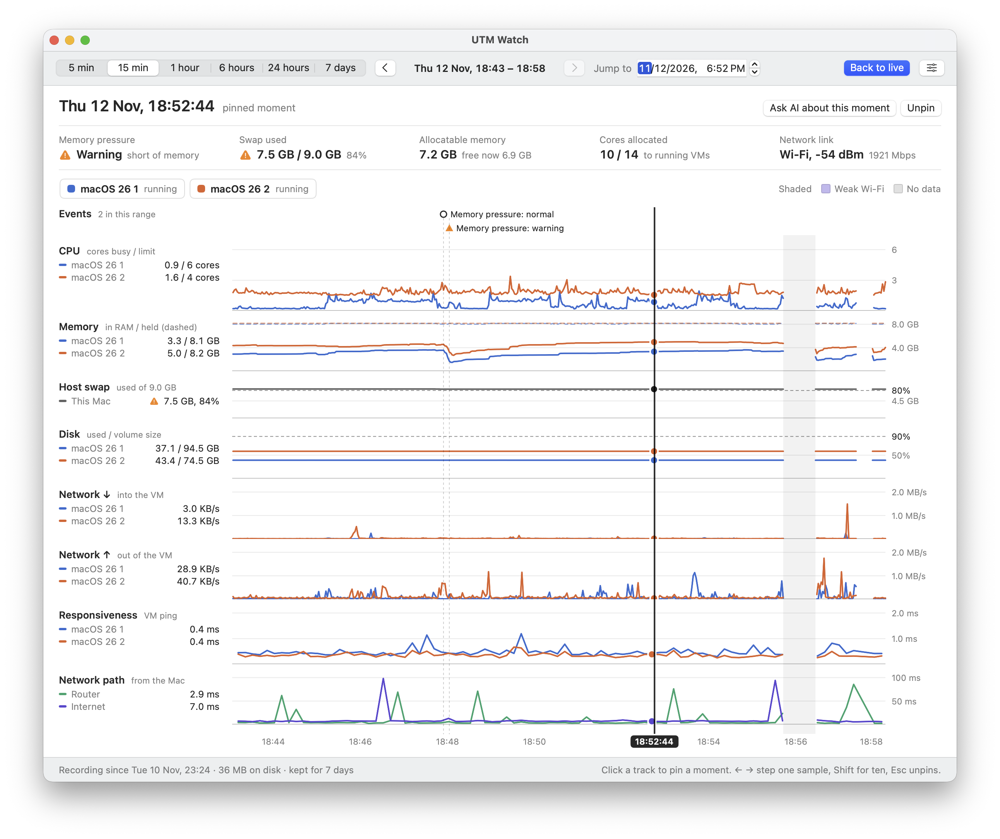
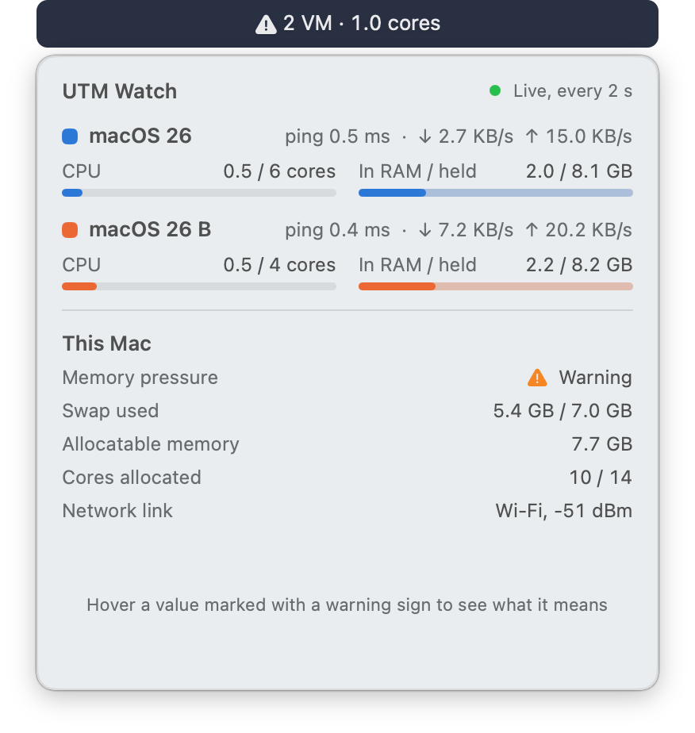
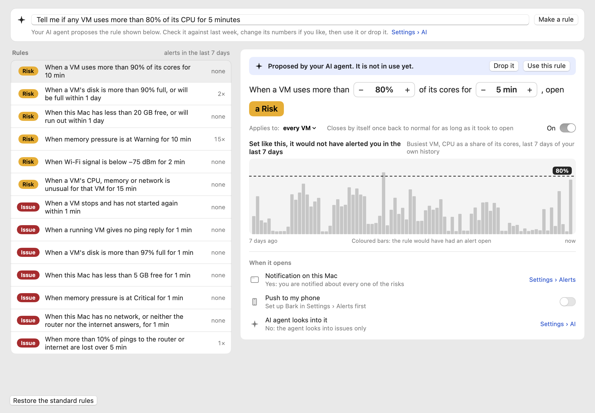
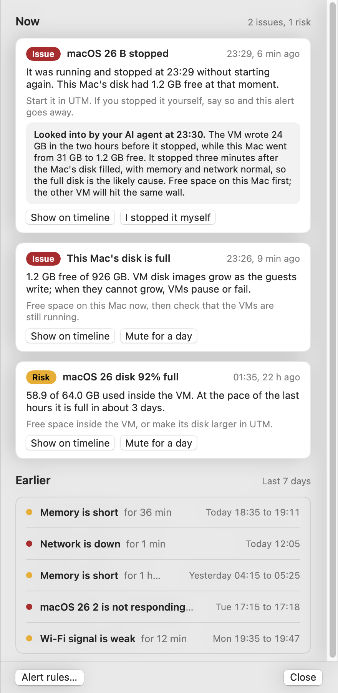
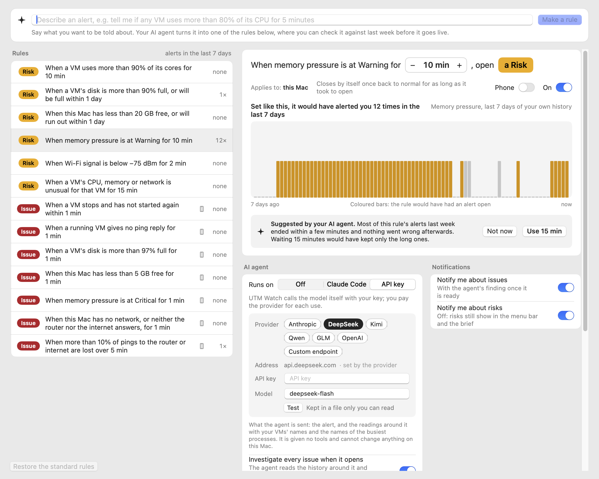
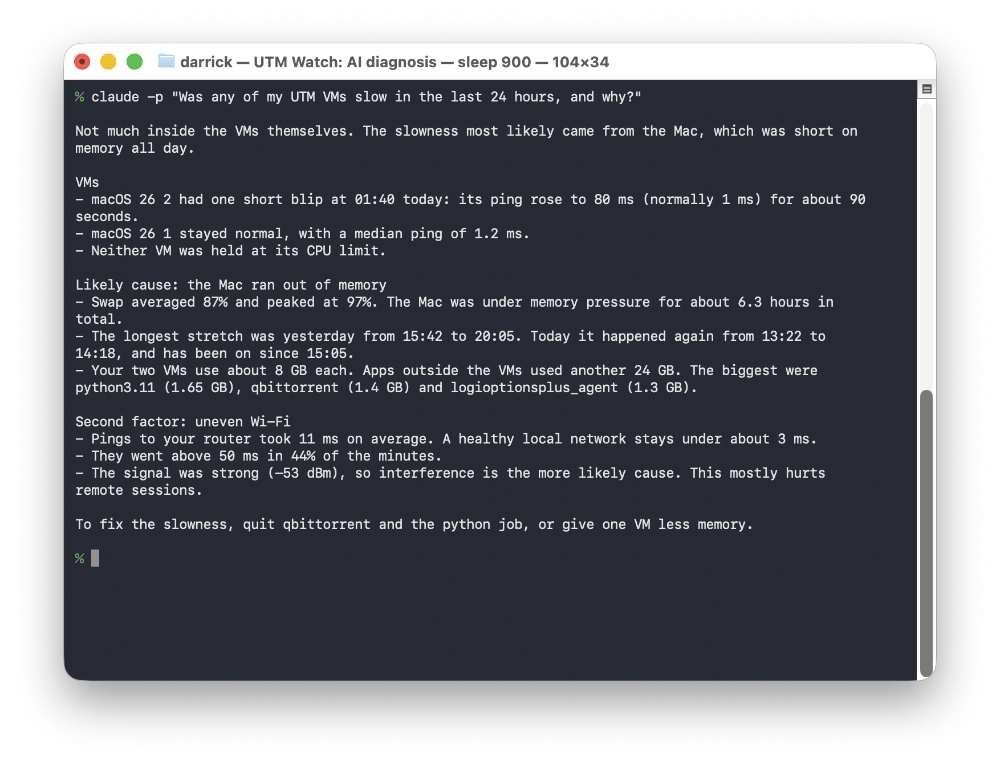
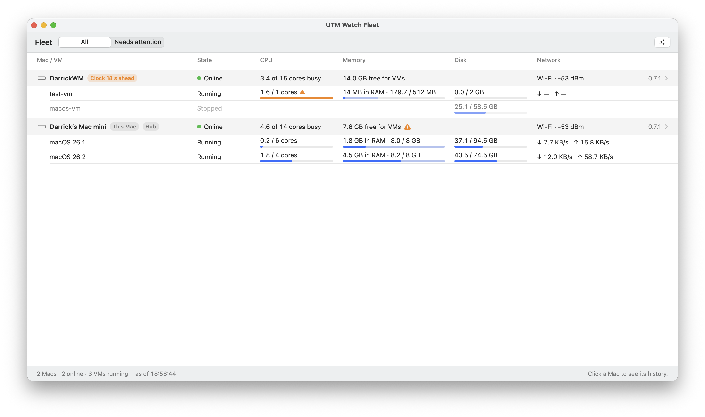

<div align="center">

# UTM Watch: a VM monitor for UTM on Mac

**See what each of your [UTM](https://mac.getutm.app) virtual machines is doing, get told when one is in trouble, and let an AI agent find out why.**

<br />

[](https://github.com/DarrickBM/utm-watch/stargazers)

[](#install)
&nbsp;
[](#install)
&nbsp;
[](#ai-built-in)
&nbsp;
[](#ai-diagnosis-with-an-mcp-server)
&nbsp;
[](LICENSE)

[Install](#install) · [Features](#features) · [AI built in](#ai-built-in) · [Alerts](#alerts) · [MCP server](#ai-diagnosis-with-an-mcp-server) · [Fleet](#monitor-several-macs-as-a-fleet) · [How it works](docs/HOW-IT-WORKS.md)

</div>



## Why UTM Watch

UTM shows whether a VM is on or off. Activity Monitor shows two processes with the same name. Neither tells you which VM is eating the CPU, how close you are to running out of memory, or whether the lag your remote user felt came from the VM, the Mac, or the Wi-Fi. UTM Watch does.

| Question | UTM | Activity Monitor | UTM Watch |
|---|---|---|---|
| Which VM is using the CPU? | No | Process names only | Every VM by name |
| How full is each VM's disk? | No | No | Yes, read from the disk image |
| What happened at 3:12 pm? | No | No | Recorded history you can scrub |
| Was it the VM, the Mac or the network? | No | No | Ping and link quality next to VM load |
| Will I be told when a VM stops or a disk fills up? | No | No | Alerts on the Mac and on your iPhone |
| Why did it happen? | No | No | An AI agent reads the history and says |

## Features

- **Every VM by name**, with CPU, memory, how full its disk is, network and ping, live in the menu bar.
- **A quick look without opening a window**: hover the menu bar item for every VM and the Mac at a glance. Click it for the full window.

  <p align="center"></p>

- **Recorded history** you can scrub back through, to see exactly what was happening at a past moment.
- **The whole connection path**: ping to each VM, to your router and to the internet, plus Wi-Fi or Ethernet link quality, so you can tell a slow VM from a slow network.
- **Fleets**: several Macs report to one hub, and one window shows every Mac and its VMs. Free, with no accounts.
- **Alerts** for risks (a disk filling up, memory short) and issues (a VM stopped, the network down), with rules you change in plain sentences, on the Mac and pushed to your iPhone. See [Alerts](#alerts).
- **An AI agent built in**, optional and on your own model: it writes a rule from a sentence, looks into each issue and says the likely cause, and tunes rules that alert too often. See [AI built in](#ai-built-in).
- **AI diagnosis** through a read-only MCP server: ask an agent such as Claude why a VM was slow, on this Mac or any Mac in the fleet, and it reads the history and tells you.
- **Works with both UTM backends**: Apple Virtualization and QEMU, with macOS, Linux and Windows guests.

UTM Watch is an independent project. It is not affiliated with or endorsed by the UTM project.

## AI built in

UTM Watch can put an AI agent to work on your VMs' history. It is optional and off by default, it runs on a model you already have, and everything else in the app works without it. Switch it on in **Alert Rules…** (right-click the menu bar item) under "AI agent".

### Say what you want to be told about

Type a sentence. The agent turns it into one of the alert rules, and the window replays that rule over your own last 7 days before you accept it, so you see how often it would have alerted you.



### Every issue comes with a likely cause

When an issue opens, the agent reads the readings around it and adds what most likely caused it, and what to do first, to the alert itself. The finding also goes into the notification, and to your iPhone if you push alerts there.

<p align="center"></p>

<p align="center"><sub>Example alerts. "Show on timeline" jumps the tracks to the moment an alert began.</sub></p>

### Rules that tune themselves, on the model you choose

Once a week the agent looks for rules that alert often for problems that end by themselves, and suggests a number that would have kept only the alerts worth an interruption. One click applies it.



**Bring your own model.** The agent runs on one of:

| Runs on | What you need |
|---|---|
| **Claude Code** | The Claude Code already on your Mac, on the plan you have. UTM Watch finds it by itself. |
| **Another command** | Any command that reads a question on standard input and answers on standard output, such as `ollama run`. |
| **API key: a provider by name** | A key for Anthropic, DeepSeek, Kimi, Qwen, GLM or OpenAI, and a model name. |
| **API key: a custom endpoint** | The address of a model on your Mac, or of any service with an OpenAI-style chat-completions API. **+ New preset**, at the end of the preset row, saves an endpoint with its model and key under a name of your own; the endpoint in use does not change until you press Save. Presets are kept in `ai-presets.json`, which you can also edit by hand. |

**What the agent is given.** No tools: it cannot run anything or change anything on your Mac. Each question carries only what it needs. For an issue that is the alert and about two hours of readings around it, with your VMs' names and the names of the largest processes; for a rule from a sentence it is the sentence and the rules. Issues are looked into at most 20 times a day. Keys are kept on your Mac in `~/Library/Application Support/UTM Watch/keys.json`, a file only your account can read; they are not encrypted.

**Prefer your own agent?** The app also ships a read-only MCP server, so Claude or another agent can read the history, the alerts and the rules itself. See [AI diagnosis with an MCP server](#ai-diagnosis-with-an-mcp-server).

## Install

Requires an Apple silicon Mac. Built and tested on macOS 26; set to run on macOS 14 or later, but older versions are untested.

**One command (recommended).** Installs the menu bar app into `/Applications`, then starts the app:

```bash
curl -fsSL https://raw.githubusercontent.com/DarrickBM/utm-watch/main/install.sh | bash
```

The script is short; read it first if you prefer: [`install.sh`](install.sh).

**Or by hand.** Download `UTMWatch-<version>-macos-arm64.dmg` from the [latest release](https://github.com/DarrickBM/utm-watch/releases/latest), open it, and drag UTM Watch into Applications. The app is not notarized by Apple, so the first time macOS will refuse to open it. Go to System Settings, then Privacy & Security, and click **Open Anyway**, or run this once:

```bash
xattr -dr com.apple.quarantine /Applications/UTMWatch.app
```

**First launch.** macOS asks for three permissions: access to data from other apps (UTM's VM files), control of UTM, and the local network (pings to your router and VMs). The app keeps working if you deny one, with less detail.

> [!IMPORTANT]
> **After an update, give the permissions again.**
> macOS treats the updated app as new. It asks for control of UTM again, and it may refuse UTM's VM files until you turn Full Disk Access for UTM Watch off and on again in System Settings › Privacy & Security, then quit UTM Watch and open it again. If it keeps refusing, use **Reset and ask again…** in UTM Watch's Settings › Permissions. Until then VMs show without their names, limits or disk usage.

## What is in the box

| Part | What it does |
|---|---|
| **Menu bar app** (`UTMWatch.app`) | Live figures in the menu bar, a hover brief, and a detail window with trend tracks and recorded history. |
| **MCP server** (`utmwatch-mcp`, inside the app) | Read-only tools over the recorded history, for AI agents. |

History is stored in `~/Library/Application Support/UTM Watch/history.sqlite`.

## Alerts

UTM Watch tells you about **risks** (something will break if it carries on: a disk filling up, memory short, a VM at its CPU limit, weak Wi-Fi) and **issues** (something is broken now: a VM stopped or stopped answering, a disk full, the network down or poor). An alert opens once, stays while the problem lasts and closes by itself. It shows as a yellow or red mark in the menu bar, at the top of the hover brief, in the Alerts list of the detail window, and as one macOS notification.

**On your iPhone.** Alerts can also be pushed to an iPhone or iPad through [Bark](https://github.com/Finb/Bark), a free app (there is no Android version). In Alert Rules… › Phone, paste the address Bark shows on the phone and send a test. Each rule has a "Phone" switch, so you choose which alerts reach the phone; issues start on and risks off. Your own Bark server works too.

Every rule is a sentence whose numbers you change in the **Alert rules** window (right-click the menu bar item). The window replays each rule over your last 7 days and says how often it would have alerted you, before you rely on it.

An optional AI agent can write a rule from a sentence, look into each issue and suggest better numbers for noisy rules. See [AI built in](#ai-built-in).

## AI diagnosis with an MCP server

The app bundle contains `utmwatch-mcp`, a read-only [Model Context Protocol](https://modelcontextprotocol.io) server over standard input/output. An agent on this Mac can use it to read the recorded history and work out why a VM was slow. Connect Claude Code with:

```bash
claude mcp add utm-watch -- /Applications/UTMWatch.app/Contents/MacOS/utmwatch-mcp
```

Then ask, for example: "A user says connecting to one of my VMs is sometimes slow. Use utm-watch to find out why."



| Tool | What it answers |
|---|---|
| `find_incidents` | When were VMs slow? Start here when someone reports slowness without a time. |
| `summarize` | What happened over a time range, VM by VM. |
| `get_moment` | Everything recorded at one moment. |
| `get_metrics` | One metric over time for a VM, the Mac or the network. |
| `list_events` | VM starts and stops, memory pressure and swap, VMs at their CPU limit, Wi-Fi and link changes, sleep and wake. |
| `get_status` | The latest sample: every VM, the Mac and the network now. |
| `list_alerts` | The alerts open now and those that ended lately, with what an AI agent found. |
| `list_alert_rules` | The alert rules as you have set them. |
| `list_macs` | Every Mac in the fleet (on a Mac that has joined one). |

Access can be switched off in the app's Settings under AI diagnosis.

## Monitor several Macs as a fleet



UTM Watch on one Mac needs nothing below. With several Macs, one of them hosts a **hub** and the others report to it; the hub Mac can then open **Open Fleet** from the menu bar item and see every Mac's VMs, and click a Mac for its history. The other Macs only report: they cannot see the fleet.

1. On the Mac that will host the hub: Settings › Fleet › **Host the hub on this Mac**, then **New pairing code**.
2. On each other Mac: Settings › Fleet, paste the code, **Join**. A code adds one Mac and works once, for 15 minutes.

A Mac that joins uploads its last 24 hours, then new history every ten seconds. If the hub cannot be reached it keeps recording and fills the gap later. The hub Mac has to stay on and logged in.

**Macs on other networks.** On the hub Mac, under "Connect Macs on other networks", paste an auth key from your own Tailscale account (reusable, tagged, pre-approved). UTM Watch then carries its own hidden Tailscale node: nothing appears in the menu bar or in System Settings, and a Tailscale you already run is left alone. Pairing codes made after that work from any network.

**A hub on a server.** The same hub runs on Linux:

```sh
docker build -f Hub/Dockerfile -t utm-watch-hub . && docker run -d -p 127.0.0.1:8787:8787 -v hub-data:/data utm-watch-hub
docker exec <container> utmwatch-hub token create --enroll --hub http://hub-address:8787     # a pairing code
```

Paste the code in each Mac's Settings › Fleet and click **Join**. Add `--view` to make a code whose Mac may also view the fleet.

**AI diagnosis across the fleet.** On a Mac that has joined, the MCP server offers `list_macs`, and every tool takes an optional `mac` (a name or UUID). Without `mac` a tool answers for the Mac it runs on, from its own database, exactly as before; that keeps working when the hub is down.

The design is in [docs/DESIGN-fleet.md](docs/DESIGN-fleet.md).

## How it works

UTM Watch reads each VM's process for CPU and memory, its `vmenetN` interface for network, and its disk image for disk usage, all read-only and without anything installed in the guest. It matches processes to VMs through the disk image each process holds open, and gets names and states from UTM's AppleScript interface. Only NAT ("Shared") networking is supported in this version; bridged VMs show no network.

[docs/HOW-IT-WORKS.md](docs/HOW-IT-WORKS.md) explains what each number means, how VMs are identified, the permissions involved and the implementation details.

## Build from source

Requires macOS 26 on Apple silicon and the Swift toolchain from Xcode or the Command Line Tools. The app has no third-party dependencies and needs no root.

Self-checks for the pure logic (Command Line Tools ship no XCTest, so this is a plain executable):

```bash
swift run selftest
```

`Scripts/make-app.sh` builds and signs `build/UTMWatch.app` (with your Apple Development certificate if you have one, otherwise ad hoc); `Scripts/make-release.sh` produces the downloadable archives in `dist/`. Design notes are in [docs/DESIGN-menu-bar-app.md](docs/DESIGN-menu-bar-app.md).

```bash
Scripts/make-app.sh
```

```bash
open build/UTMWatch.app
```

To connect Claude Code to a build from source:

```bash
claude mcp add utm-watch -- "$(pwd)/build/UTMWatch.app/Contents/MacOS/utmwatch-mcp"
```

## Contributing

Bug reports and pull requests are welcome. See [CONTRIBUTING.md](CONTRIBUTING.md).

## License

MIT. See [LICENSE](LICENSE).

---

<div align="center">

Built by [DarrickBM](https://github.com/DarrickBM)

<br />

**If UTM Watch is useful to you:**

[](https://github.com/DarrickBM/utm-watch/stargazers)

</div>
