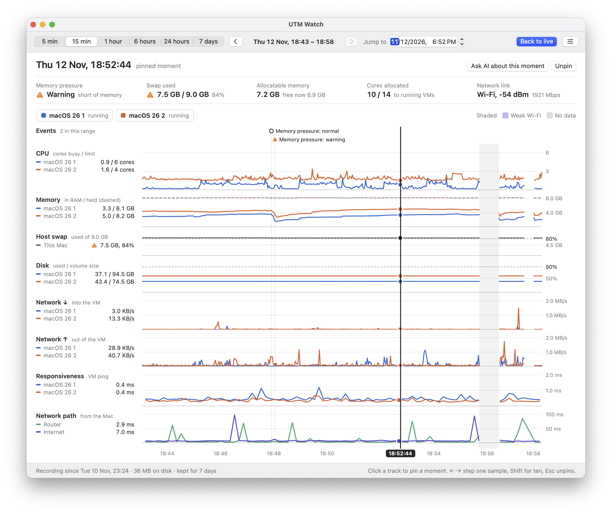
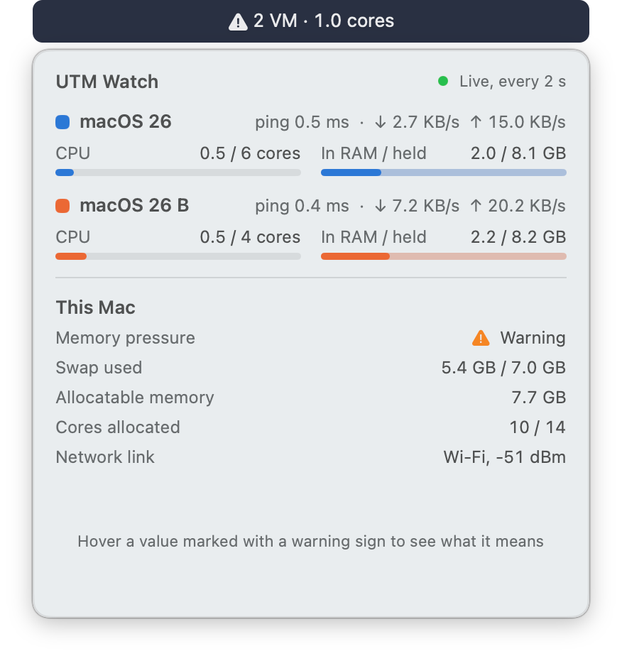
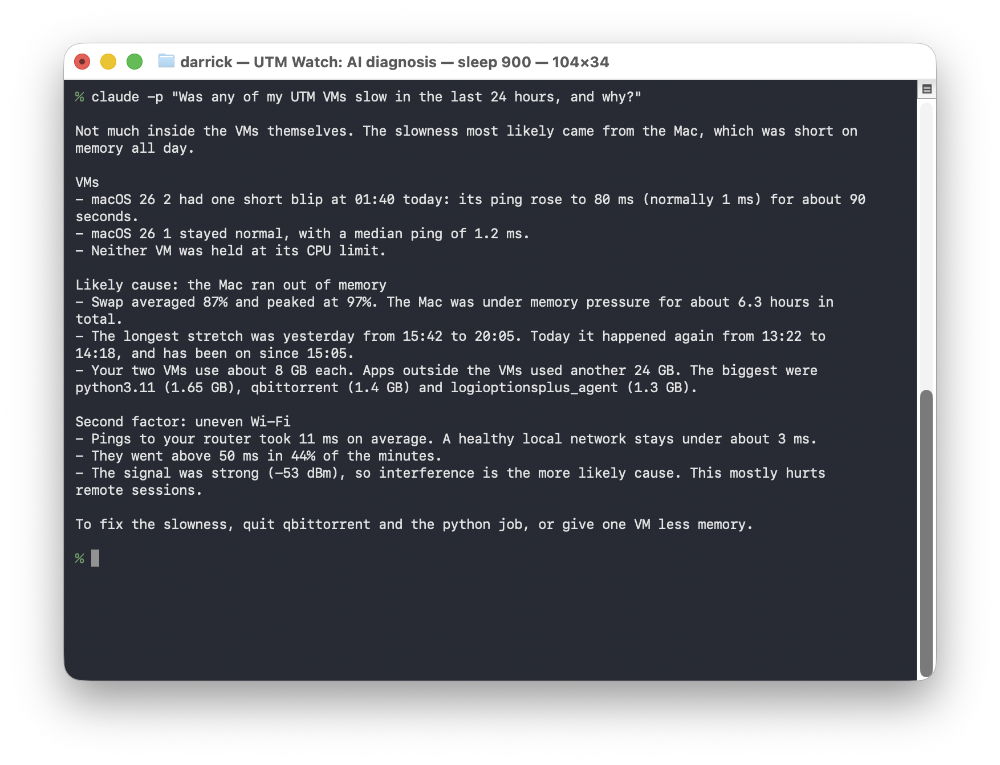
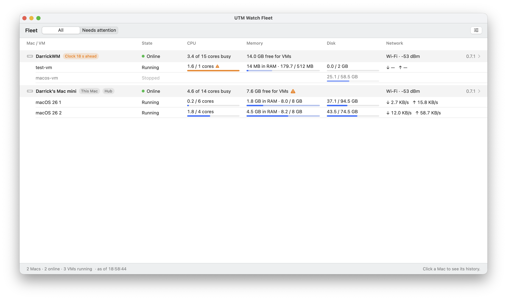

<div align="center">

# UTM Watch: a VM monitor for UTM on Mac

**See what each of your [UTM](https://mac.getutm.app) virtual machines is doing, and find out why one was slow.**

<br />

[](https://github.com/DarrickBM/utm-watch/stargazers)

[](#install)
&nbsp;
[](#install)
&nbsp;
[](#ai-diagnosis-with-an-mcp-server)
&nbsp;
[](LICENSE)

[Install](#install) · [Features](#features) · [AI diagnosis](#ai-diagnosis-with-an-mcp-server) · [Fleet](#monitor-several-macs-as-a-fleet) · [Terminal tool](#terminal-tool) · [How it works](docs/HOW-IT-WORKS.md)

</div>



## Why UTM Watch

UTM shows whether a VM is on or off. Activity Monitor shows two processes with the same name. Neither tells you which VM is eating the CPU, how close you are to running out of memory, or whether the lag your remote user felt came from the VM, the Mac, or the Wi-Fi. UTM Watch does.

| Question | UTM | Activity Monitor | UTM Watch |
|---|---|---|---|
| Which VM is using the CPU? | No | Process names only | Every VM by name |
| How full is each VM's disk? | No | No | Yes, read from the disk image |
| What happened at 3:12 pm? | No | No | Recorded history you can scrub |
| Was it the VM, the Mac or the network? | No | No | Ping and link quality next to VM load |

## Features

- **Every VM by name**, with CPU, memory, how full its disk is, network and ping, live in the menu bar.
- **A quick look without opening a window**: hover the menu bar item for every VM and the Mac at a glance. Click it for the full window.

  <p align="center"></p>

- **Recorded history** you can scrub back through, to see exactly what was happening at a past moment.
- **The whole connection path**: ping to each VM, to your router and to the internet, plus Wi-Fi or Ethernet link quality, so you can tell a slow VM from a slow network.
- **Fleets**: several Macs report to one hub, and one window shows every Mac and its VMs. Free, with no accounts.
- **AI diagnosis** through a read-only MCP server: ask an agent such as Claude why a VM was slow, on this Mac or any Mac in the fleet, and it reads the history and tells you.
- **Works with both UTM backends**: Apple Virtualization and QEMU, with macOS, Linux and Windows guests.

UTM Watch is an independent project. It is not affiliated with or endorsed by the UTM project.

## Install

Requires an Apple silicon Mac. Built and tested on macOS 26; set to run on macOS 14 or later, but older versions are untested.

**One command (recommended).** Installs the menu bar app into `/Applications` and the `utmwatch` terminal tool, then starts the app:

```bash
curl -fsSL https://raw.githubusercontent.com/DarrickBM/utm-watch/main/install.sh | bash
```

The script is short; read it first if you prefer: [`install.sh`](install.sh).

**Or by hand.** Download `UTMWatch-<version>-macos-arm64.dmg` from the [latest release](https://github.com/DarrickBM/utm-watch/releases/latest), open it, and drag UTM Watch into Applications. The app is not notarized by Apple, so the first time macOS will refuse to open it. Go to System Settings, then Privacy & Security, and click **Open Anyway**, or run this once:

```bash
xattr -dr com.apple.quarantine /Applications/UTMWatch.app
```

**First launch.** macOS asks for three permissions: access to data from other apps (UTM's VM files), control of UTM, and the local network (pings to your router and VMs). The app keeps working if you deny one, with less detail.

> [!IMPORTANT]
> **After an update, give the permissions again.**
> macOS treats the updated app as new. It asks for control of UTM again, and it may refuse UTM's VM files until you turn Full Disk Access for UTM Watch off and on again in System Settings › Privacy & Security, then quit UTM Watch and open it again. If it keeps refusing, use **Reset and ask again…** in UTM Watch's Settings › Permissions. Until then VMs show without their names, limits or disk usage.

## What is in the box

| Part | What it does |
|---|---|
| **Menu bar app** (`UTMWatch.app`) | Live figures in the menu bar, a hover brief, and a detail window with trend tracks and recorded history. |
| **Terminal tool** (`utmwatch`) | The same live table in a terminal, or one JSON snapshot for scripts. |
| **MCP server** (`utmwatch-mcp`, inside the app) | Read-only tools over the recorded history, for AI agents. |

History is stored in `~/Library/Application Support/UTM Watch/history.sqlite`.

## AI diagnosis with an MCP server

The app bundle contains `utmwatch-mcp`, a read-only [Model Context Protocol](https://modelcontextprotocol.io) server over standard input/output. An agent on this Mac can use it to read the recorded history and work out why a VM was slow. Connect Claude Code with:

```bash
claude mcp add utm-watch -- /Applications/UTMWatch.app/Contents/MacOS/utmwatch-mcp
```

Then ask, for example: "A user says connecting to one of my VMs is sometimes slow. Use utm-watch to find out why."



| Tool | What it answers |
|---|---|
| `find_incidents` | When were VMs slow? Start here when someone reports slowness without a time. |
| `summarize` | What happened over a time range, VM by VM. |
| `get_moment` | Everything recorded at one moment. |
| `get_metrics` | One metric over time for a VM, the Mac or the network. |
| `list_events` | VM starts and stops, memory pressure and swap, VMs at their CPU limit, Wi-Fi and link changes, sleep and wake. |
| `get_status` | The latest sample: every VM, the Mac and the network now. |
| `list_macs` | Every Mac in the fleet (on a Mac that has joined one). |

Access can be switched off in the app's Settings under AI diagnosis.

## Monitor several Macs as a fleet



UTM Watch on one Mac needs nothing below. With several Macs, one of them hosts a **hub** and the others report to it; the hub Mac can then open **Open Fleet** from the menu bar item and see every Mac's VMs, and click a Mac for its history. The other Macs only report: they cannot see the fleet.

1. On the Mac that will host the hub: Settings › Fleet › **Host the hub on this Mac**, then **New pairing code**.
2. On each other Mac: Settings › Fleet, paste the code, **Join**. A code adds one Mac and works once, for 15 minutes.

A Mac that joins uploads its last 24 hours, then new history every ten seconds. If the hub cannot be reached it keeps recording and fills the gap later. The hub Mac has to stay on and logged in.

**Macs on other networks.** On the hub Mac, under "Connect Macs on other networks", paste an auth key from your own Tailscale account (reusable, tagged, pre-approved). UTM Watch then carries its own hidden Tailscale node: nothing appears in the menu bar or in System Settings, and a Tailscale you already run is left alone. Pairing codes made after that work from any network.

**A hub on a server.** The same hub runs on Linux:

```sh
docker build -f Hub/Dockerfile -t utm-watch-hub . && docker run -d -p 127.0.0.1:8787:8787 -v hub-data:/data utm-watch-hub
docker exec <container> utmwatch-hub token create --enroll     # a pairing token
utmwatch fleet enroll --hub http://hub-address:8787 --code <token>
```

**AI diagnosis across the fleet.** On a Mac that has joined, the MCP server offers `list_macs`, and every tool takes an optional `mac` (a name or UUID). Without `mac` a tool answers for the Mac it runs on, from its own database, exactly as before; that keeps working when the hub is down.

`utmwatch fleet status`, `leave`, `view` and `sim` are command-line equivalents and testing aids. The design is in [docs/DESIGN-fleet.md](docs/DESIGN-fleet.md).

## Terminal tool

`utmwatch` lists every running virtual machine on this Mac **by its UTM name** with live CPU, memory and network usage, and tells you how much memory and how many cores are still allocatable.

```
utmwatch · 2 VM · 4.2 cores · refresh 2s                                 00:34:00

VM          State     Backend             CPU          Memory       ↓ Down         ↑ Up         Total ↓/↑
macOS 26    running   Apple     1.1 / 6 cores      8.1 / 8 GB    24.9 KB/s    46.2 KB/s   662 MB / 1.3 GB
macOS 26 B  running   Apple     2.8 / 4 cores      8.1 / 8 GB   121.3 KB/s   128.0 KB/s   7.3 GB / 2.0 GB
──────────────────────────────────────────────────────────────────────────────────────────────────────────
Headroom  macOS VMs 2/2 (full)  ·  Allocatable 8.7 GB (free now 8.5 GB)  ·  Cores allocated 10/14
Host      Memory pressure normal  ·  Swap 3.1 GB / 4.0 GB  ·  Used 39.5 GB of 48.0 GB (23.3 GB outside VMs)
```

| Flag | Meaning |
|---|---|
| `--interval 1\|2\|5` | Refresh interval in seconds (default 2) |
| `--once` | Print one table and exit (two samples, `interval` apart) |
| `--json` | With `--once`: print the snapshot as JSON (for scripts, Hermes, etc.) |
| `--units mb\|mbps` | Network in MB/s (default) or Mbps |
| `--hide-stopped` | Start with stopped VMs hidden |
| `--no-utm` | Skip the UTM AppleScript query; names come from `.utm` bundles only |
| `--swap-directions` | Treat vmenet in/out the other way round (see [Traffic direction](docs/HOW-IT-WORKS.md#traffic-direction)) |
| `--log <path>` | Append collector errors to a file |

Keys while running: `1` `2` `5` change the interval (takes effect immediately), `s` cycles the sort (name, CPU, memory, network), `h` hides/shows stopped VMs, `u` toggles MB/s and Mbps, `r` re-reads the VM list now, `q` quits.

## How it works

UTM Watch reads each VM's process for CPU and memory, its `vmenetN` interface for network, and its disk image for disk usage, all read-only and without anything installed in the guest. It matches processes to VMs through the disk image each process holds open, and gets names and states from UTM's AppleScript interface. Only NAT ("Shared") networking is supported in this version; bridged VMs show no network.

[docs/HOW-IT-WORKS.md](docs/HOW-IT-WORKS.md) explains what each number means, how VMs are identified, the permissions involved and the implementation details.

## Build from source

Requires macOS 26 on Apple silicon and the Swift toolchain from Xcode or the Command Line Tools. The terminal tool and the app have no third-party dependencies and need no root.

```bash
swift build -c release
.build/release/utmwatch
```

Self-checks for the pure logic (Command Line Tools ship no XCTest, so this is a plain executable):

```bash
swift run selftest
```

`Scripts/make-app.sh` builds and signs `build/UTMWatch.app` (with your Apple Development certificate if you have one, otherwise ad hoc); `Scripts/make-release.sh` produces the downloadable archives in `dist/`. Design notes are in [docs/DESIGN-menu-bar-app.md](docs/DESIGN-menu-bar-app.md).

```bash
Scripts/make-app.sh
```

```bash
open build/UTMWatch.app
```

To connect Claude Code to a build from source:

```bash
claude mcp add utm-watch -- "$(pwd)/build/UTMWatch.app/Contents/MacOS/utmwatch-mcp"
```

## Contributing

Bug reports and pull requests are welcome. See [CONTRIBUTING.md](CONTRIBUTING.md).

## License

MIT. See [LICENSE](LICENSE).

---

<div align="center">

Built by [DarrickBM](https://github.com/DarrickBM)

<br />

**If UTM Watch is useful to you:**

[](https://github.com/DarrickBM/utm-watch/stargazers)

</div>
